# Diagramme entités-relations

Généré depuis le catalogue PostgreSQL d'une base migrée (EX-101 n° 7) : ne pas modifier à la main.
Régénérer avec `pnpm --filter @oz/db db:er` ; un test échoue si ce fichier n'est plus à jour.
Les partitions mensuelles de `audit_log` ne sont pas représentées.

```mermaid
erDiagram
  account_deletion_requests {
    uuid id PK
    uuid user_id FK
    text status
    timestamptz requested_at
    timestamptz scheduled_for
    timestamptz cancelled_at
    timestamptz completed_at
    timestamptz updated_at
    uuid player_id FK
    uuid requested_by_user_id FK
  }
  audit_chain_checks {
    uuid id PK
    timestamptz checked_at
    bigint head_position
    bigint anchor_position
    bigint defect_position
  }
  audit_chain_state {
    boolean id PK
    bigint last_position
    bytea last_hash
  }
  audit_log {
    uuid id PK
    bigint chain_position
    uuid actor_user_id FK
    text action
    text target_type
    uuid target_id
    text reason
    text request_id
    jsonb metadata
    bytea prev_hash
    bytea hash
    timestamptz created_at PK
  }
  auth_recovery_codes {
    uuid id PK
    uuid user_id FK
    text code_hash
    timestamptz consumed_at
    timestamptz created_at
  }
  auth_tokens {
    uuid id PK
    uuid user_id FK
    auth_token_purpose purpose
    text token_hash
    timestamptz expires_at
    timestamptz consumed_at
    timestamptz created_at
  }
  consents {
    uuid id PK
    consent_type type
    text text_version
    uuid player_id FK
    uuid granted_by_user_id FK
    uuid granted_by_guardian_id FK
    timestamptz granted_at
    timestamptz revoked_at
    timestamptz created_at
    timestamptz updated_at
    timestamptz deleted_at
    uuid created_by FK
    uuid updated_by FK
  }
  data_export_requests {
    uuid id PK
    uuid user_id FK
    text status
    timestamptz requested_at
    timestamptz ready_at
    timestamptz expires_at
    text storage_key
    text failure_reason
    timestamptz updated_at
  }
  document_duplicates {
    uuid document_id PK,FK
    uuid duplicate_of_id FK
    timestamptz created_at
  }
  document_uploads {
    uuid id PK
    uuid requested_by FK
    document_type document_type
    uuid player_id FK
    uuid guardian_id FK
    uuid organization_id FK
    text content_type
    bigint size_bytes
    text sha256
    upload_status status
    timestamptz expires_at
    timestamptz completed_at
    uuid document_id FK
    text reject_reason
    timestamptz created_at
  }
  documents {
    uuid id PK
    document_type type
    uuid player_id FK
    uuid guardian_id FK
    uuid organization_id FK
    uuid uploaded_by FK
    text storage_key
    text mime_type
    bigint size_bytes
    text sha256
    av_status av_status
    timestamptz av_checked_at
    bytea ocr_extract_encrypted
    bytea document_number_encrypted
    bytea document_number_hmac
    timestamptz retention_until
    timestamptz created_at
    timestamptz updated_at
    timestamptz deleted_at
    uuid created_by FK
    uuid updated_by FK
    text rejection_reason
    integer width
    integer height
    integer page_count
    bigint perceptual_hash
    timestamptz purged_at
  }
  guardians {
    uuid id PK
    uuid user_id FK
    text first_name
    text last_name
    guardian_relationship relationship
    text country
    bytea phone_encrypted
    bytea phone_hmac
    bytea email_encrypted
    bytea email_hmac
    bytea document_number_encrypted
    bytea document_number_hmac
    verification_status verification_status
    timestamptz created_at
    timestamptz updated_at
    timestamptz deleted_at
    uuid created_by FK
    uuid updated_by FK
  }
  imports {
    uuid id PK
    uuid organization_id FK
    import_source source
    text file_name
    text file_sha256
    text file_storage_key
    jsonb mapping
    import_status status
    integer rows_total
    integer rows_ok
    integer rows_rejected
    integer rows_duplicate
    text report_key
    timestamptz started_at
    timestamptz finished_at
    timestamptz created_at
    timestamptz updated_at
    timestamptz deleted_at
    uuid created_by FK
    uuid updated_by FK
  }
  kyc_case_documents {
    uuid kyc_case_id PK,FK
    uuid document_id PK,FK
    timestamptz created_at
    uuid created_by FK
  }
  kyc_cases {
    uuid id PK
    uuid player_id FK
    uuid organization_id FK
    smallint level
    kyc_status status
    jsonb checks
    timestamptz submitted_at
    uuid decided_by FK
    uuid second_decided_by FK
    text decision_reason
    timestamptz decided_at
    timestamptz created_at
    timestamptz updated_at
    timestamptz deleted_at
    uuid created_by FK
    uuid updated_by FK
  }
  notifications {
    uuid id PK
    uuid recipient_user_id FK
    notification_channel channel
    text template
    jsonb payload
    notification_status status
    smallint attempts
    text last_error
    timestamptz scheduled_at
    timestamptz sent_at
    timestamptz read_at
    timestamptz created_at
    timestamptz updated_at
    timestamptz deleted_at
  }
  organizations {
    uuid id PK,FK
    organization_type type
    text name
    text registration_number
    text country
    text region
    text city
    text contact_email
    verification_status verification_status
    timestamptz created_at
    timestamptz updated_at
    timestamptz deleted_at
    uuid created_by FK
    uuid updated_by FK
    uuid subscription_id FK
  }
  oz_id_registry {
    text oz_id PK
    uuid player_id FK
    timestamptz issued_at
  }
  player_signups {
    uuid id PK
    uuid user_id FK
    bytea identity
    bytea sport
    bytea affiliation
    bytea guardian
    timestamptz created_at
    timestamptz updated_at
    timestamptz expires_at
  }
  players {
    uuid id PK,FK
    uuid user_id FK
    text oz_id FK
    text first_name
    text last_name
    date birth_date
    text nationality
    text country
    text region
    text city
    bytea phone_encrypted
    bytea phone_hmac
    bytea document_number_encrypted
    bytea document_number_hmac
    player_position primary_position
    player_position secondary_position
    dominant_foot dominant_foot
    smallint height_cm
    smallint weight_kg
    verification_status verification_status
    uuid guardian_id FK
    uuid organization_id FK
    jsonb visibility
    timestamptz created_at
    timestamptz updated_at
    timestamptz deleted_at
    uuid created_by FK
    uuid updated_by FK
    tsvector search_vector
  }
  saved_searches {
    uuid id PK
    uuid user_id FK
    text name
    jsonb criteria
    text sort
    text direction
    timestamptz created_at
  }
  search_exports {
    uuid id PK
    uuid user_id FK
    uuid organization_id FK
    integer row_count
    text sort
    text_array criteria_keys
    timestamptz created_at
  }
  sessions {
    uuid id PK
    uuid user_id FK
    uuid family_id
    text refresh_token_hash
    text user_agent
    text device_fingerprint
    inet ip
    timestamptz expires_at
    timestamptz last_used_at
    timestamptz revoked_at
    timestamptz created_at
    timestamptz updated_at
    timestamptz deleted_at
    text revoked_reason
    timestamptz family_expires_at
  }
  subscriptions {
    uuid id PK
    uuid organization_id FK
    text tier
    subscription_status status
    payment_provider provider
    text provider_reference
    timestamptz period_start
    timestamptz period_end
    jsonb quotas
    timestamptz cancelled_at
    timestamptz created_at
    timestamptz updated_at
    timestamptz deleted_at
    uuid created_by FK
    uuid updated_by FK
  }
  system_settings {
    uuid id PK
    text key
    jsonb value
    timestamptz created_at
    timestamptz updated_at
  }
  user_roles {
    uuid id PK
    uuid user_id FK
    role_kind role
    uuid organization_id FK
    timestamptz created_at
    timestamptz updated_at
    timestamptz deleted_at
    uuid created_by FK
    uuid updated_by FK
  }
  users {
    uuid id PK
    text email
    text password_hash
    user_status status
    bytea totp_secret_encrypted
    timestamptz totp_enabled_at
    timestamptz email_verified_at
    timestamptz phone_verified_at
    timestamptz last_seen_at
    timestamptz created_at
    timestamptz updated_at
    timestamptz deleted_at
    bytea totp_pending_secret_encrypted
    bigint totp_last_step
    bytea phone_encrypted
    bytea phone_hmac
  }
  account_deletion_requests }o--o| players : "player_id"
  account_deletion_requests }o--o| users : "requested_by_user_id"
  account_deletion_requests }o--o| users : "user_id"
  audit_log }o--o| users : "actor_user_id"
  auth_recovery_codes }o--|| users : "user_id"
  auth_tokens }o--|| users : "user_id"
  consents }o--o| guardians : "granted_by_guardian_id"
  consents }o--o| players : "player_id"
  consents }o--o| users : "created_by"
  consents }o--o| users : "granted_by_user_id"
  consents }o--o| users : "updated_by"
  data_export_requests }o--|| users : "user_id"
  document_duplicates }o--|| documents : "document_id"
  document_duplicates }o--|| documents : "duplicate_of_id"
  document_uploads }o--o| documents : "document_id"
  document_uploads }o--o| guardians : "guardian_id"
  document_uploads }o--o| organizations : "organization_id"
  document_uploads }o--o| players : "player_id"
  document_uploads }o--|| users : "requested_by"
  documents }o--o| guardians : "guardian_id"
  documents }o--o| organizations : "organization_id"
  documents }o--o| players : "player_id"
  documents }o--o| users : "created_by"
  documents }o--o| users : "updated_by"
  documents }o--|| users : "uploaded_by"
  guardians }o--o| users : "created_by"
  guardians }o--o| users : "updated_by"
  guardians }o--o| users : "user_id"
  imports }o--|| organizations : "organization_id"
  imports }o--o| users : "created_by"
  imports }o--o| users : "updated_by"
  kyc_case_documents }o--|| documents : "document_id"
  kyc_case_documents }o--|| kyc_cases : "kyc_case_id"
  kyc_case_documents }o--o| users : "created_by"
  kyc_cases }o--o| organizations : "organization_id"
  kyc_cases }o--o| players : "player_id"
  kyc_cases }o--o| users : "created_by"
  kyc_cases }o--o| users : "decided_by"
  kyc_cases }o--o| users : "second_decided_by"
  kyc_cases }o--o| users : "updated_by"
  notifications }o--|| users : "recipient_user_id"
  organizations }o--o| subscriptions : "subscription_id,id"
  organizations }o--o| users : "created_by"
  organizations }o--o| users : "updated_by"
  oz_id_registry }o--|| players : "player_id"
  player_signups }o--|| users : "user_id"
  players }o--o| guardians : "guardian_id"
  players }o--o| organizations : "organization_id"
  players }o--o| oz_id_registry : "oz_id,id"
  players }o--o| users : "created_by"
  players }o--o| users : "updated_by"
  players }o--o| users : "user_id"
  saved_searches }o--|| users : "user_id"
  search_exports }o--o| organizations : "organization_id"
  search_exports }o--|| users : "user_id"
  sessions }o--|| users : "user_id"
  subscriptions }o--|| organizations : "organization_id"
  subscriptions }o--o| users : "created_by"
  subscriptions }o--o| users : "updated_by"
  user_roles }o--o| organizations : "organization_id"
  user_roles }o--o| users : "created_by"
  user_roles }o--o| users : "updated_by"
  user_roles }o--|| users : "user_id"
```

